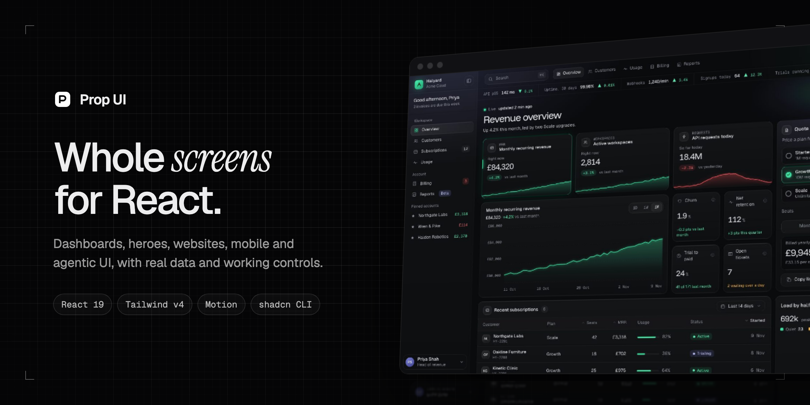
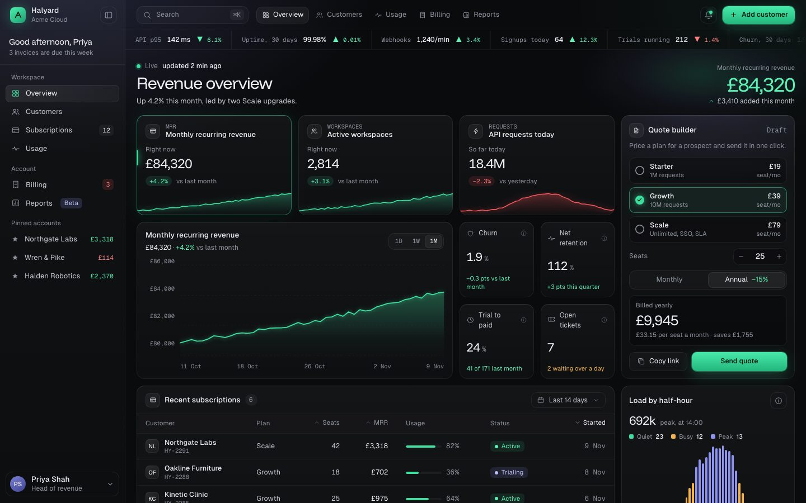
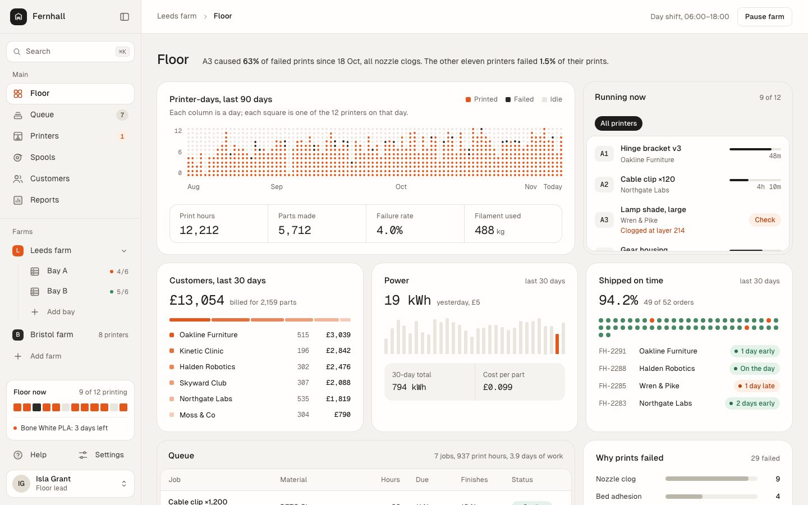
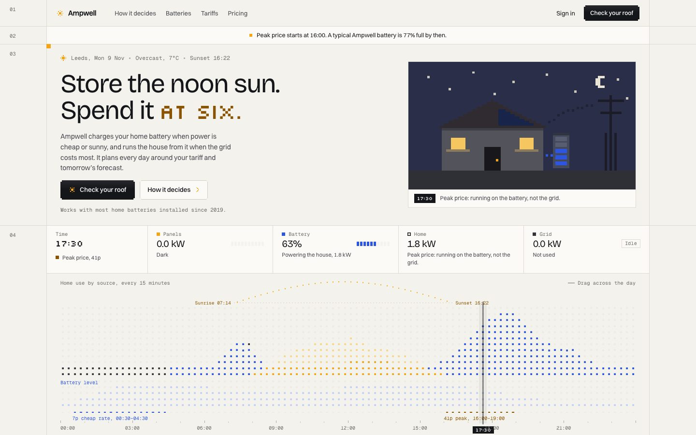
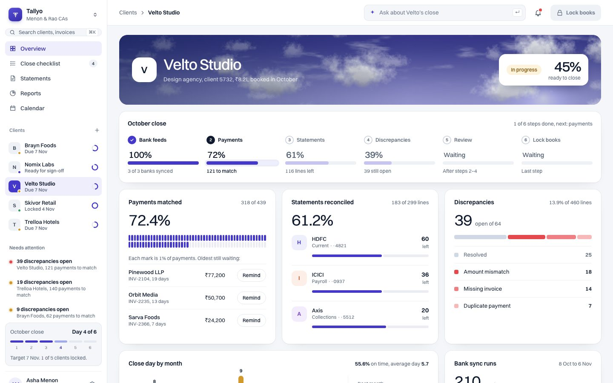
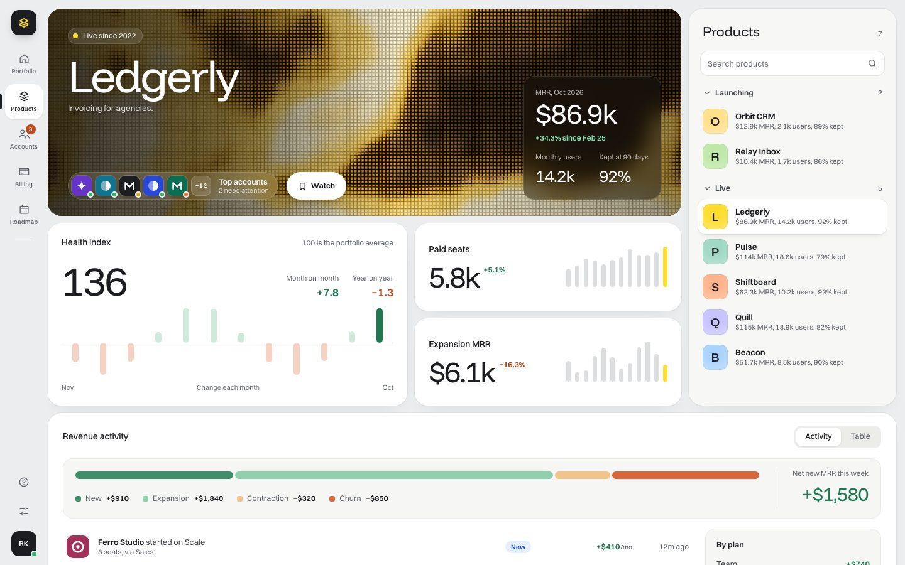

<p align="center">
  <a href="https://propui.dev"></a>
</p>

<p align="center">
  <b>Whole screens and agentic UI for React.</b> Dashboards, heroes, websites, mobile UIs and interfaces for AI agents,<br>
  with real data and working controls. Each piece is one self-contained folder you drop into your app.
</p>

<p align="center">
  <a href="https://propui.dev">Website</a> ·
  <a href="https://propui.dev/docs">Docs</a> ·
  <a href="https://propui.dev/docs/ai">AI &amp; MCP</a> ·
  <a href="https://propui.dev/docs/changelog">Changelog</a>
</p>

<p align="center">
  
  
  
  
</p>

---

## The library

<table>
  <tr>
    <td width="50%"><a href="https://propui.dev/p/halyard-saas"></a><br><b>Halyard</b> · SaaS revenue and usage dashboard<br><sub>In this repo</sub></td>
    <td width="50%"><a href="https://propui.dev/p/fernhall-print-farm"></a><br><b>Fernhall</b> · Print farm floor dashboard<br><sub>In this repo</sub></td>
  </tr>
  <tr>
    <td width="50%"><a href="https://propui.dev/p/ampwell-hero"></a><br><b>Ampwell</b> · Home battery hero<br><sub>On propui.dev</sub></td>
    <td width="50%"><a href="https://propui.dev/p/tallyo-close"></a><br><b>Tallyo</b> · Month-end close dashboard<br><sub>On propui.dev</sub></td>
  </tr>
  <tr>
    <td width="50%"><a href="https://propui.dev/p/stackwise-portfolio"></a><br><b>Stackwise</b> · SaaS portfolio dashboard<br><sub>On propui.dev</sub></td>
    <td width="50%" align="center"><br><b>More every week</b><br><sub>Agentic UI is next: chat, tool calls and agent dashboards.<br>Then websites, mobile UIs and templates.<br><a href="https://propui.dev">Get notified when a piece ships →</a></sub></td>
  </tr>
</table>

Every piece is free. Pieces marked *In this repo* are open source here under MIT; the rest are free on [propui.dev](https://propui.dev) because they include parts we can't relicense.

## Install

**With the shadcn CLI.** Sign in to [propui.dev](https://propui.dev/signin) (free, email or Google), open a piece and copy its install command. It includes your personal token:

```bash
npx shadcn@latest add "https://propui.dev/r/halyard-saas.json?token=YOUR_TOKEN"
```

**From this repo.** Copy a folder from [`pieces/`](pieces) into `components/propui/`, keep its `fonts/` folder, and install Motion (pieces load fonts with `next/font/local`, so they expect Next.js):

```bash
npm install motion
```

Then render it in a full-height container:

```tsx
import Piece from "@/components/propui/05-halyard-saas/Section";

export default function Page() {
  return (
    <main className="h-dvh w-full overflow-hidden">
      <Piece />
    </main>
  );
}
```

## What makes a piece

- **A real product, not a demo.** Each screen is built for one imagined company, with believable data in `data.ts`.
- **Working controls.** Tabs switch, charts respond, tables sort, forms add up.
- **Self-contained.** Classes are prefixed and the stylesheet is scoped, so a piece never clashes with your styles.
- **Checked before it ships.** Every piece passes layout, accessibility (WCAG AA) and motion checks at phone, tablet and desktop widths.
- **Motion that respects people.** Animations use Motion and honour `prefers-reduced-motion`.

## Use it with AI

Prop UI has an MCP server, so Claude, Cursor and other assistants can search the library and install pieces for you:

```bash
claude mcp add --transport http propui https://propui.dev/api/mcp
```

Every piece also has a Markdown reference, and the whole library is described at [propui.dev/llms.txt](https://propui.dev/llms.txt).

## Licence

Code in this repo is [MIT](LICENSE). Fonts in each `fonts/` folder are under the SIL Open Font License; see the `OFL.txt` beside them.

<p align="center"><sub>Made by Rhydar · <a href="https://propui.dev">propui.dev</a></sub></p>
